

<a href="https://github.com/sebhoudelet-afk/NOVA-CONNECTOR-releases/releases/latest">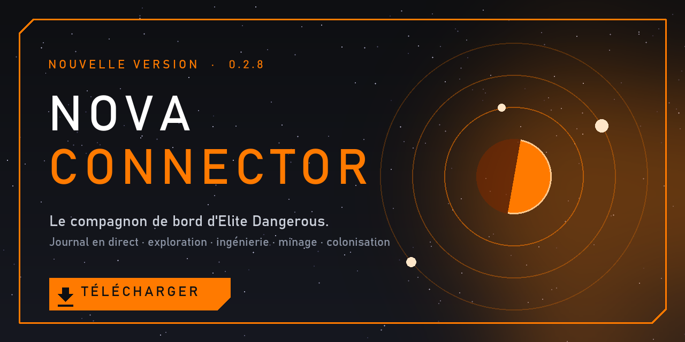</a>

# Nova Connector

**Le compagnon de bord d'Elite Dangerous** : ton journal de jeu en direct, tes données partagées avec la communauté,
et des outils pour l'exploration, l'ingénierie, le minage, le commerce, la colonisation et ton porte-vaisseau.

  

### [⬇ Télécharger Nova Connector](https://github.com/sebhoudelet-afk/NOVA-CONNECTOR-releases/releases/latest)

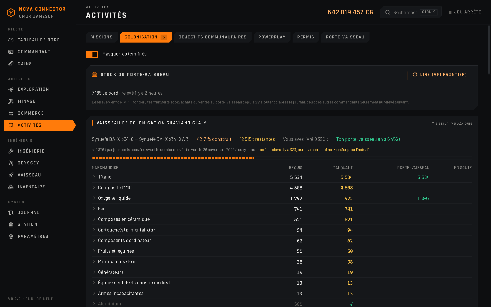

## Installation

1. Ouvre la [dernière version](https://github.com/sebhoudelet-afk/NOVA-CONNECTOR-releases/releases/latest) et télécharge **`Nova.Connector_x.y.z_x64-setup.exe`**.
2. Lance l'installateur. Il n'est pas encore signé : Windows SmartScreen affiche un avertissement, clique sur **Informations complémentaires** puis **Exécuter quand même**.
3. Lance Nova Connector : un assistant t'aide à le régler en quelques écrans, puis il lit le journal du jeu tout seul, en direct et depuis ton historique.
4. Facultatif, pour le marché, le chantier naval, le stock de ton porte-vaisseau et les infos de ton escadron : page **Station → Se connecter avec Frontier**, une seule fois, avec ton compte Frontier, Steam ou Epic. Rien d'autre à configurer.

Ensuite, les nouvelles versions s'installent d'elles-mêmes : l'appli vérifie les mises à jour au démarrage. Les données de référence (exobiologie, points chauds, ingénierie…) se mettent aussi à jour sans nouvelle version.

## Nouveautés de la 0.2.8

### La route exacte, calculée pour ton vaisseau

<table>
  <tr>
    <td width="55%" valign="top">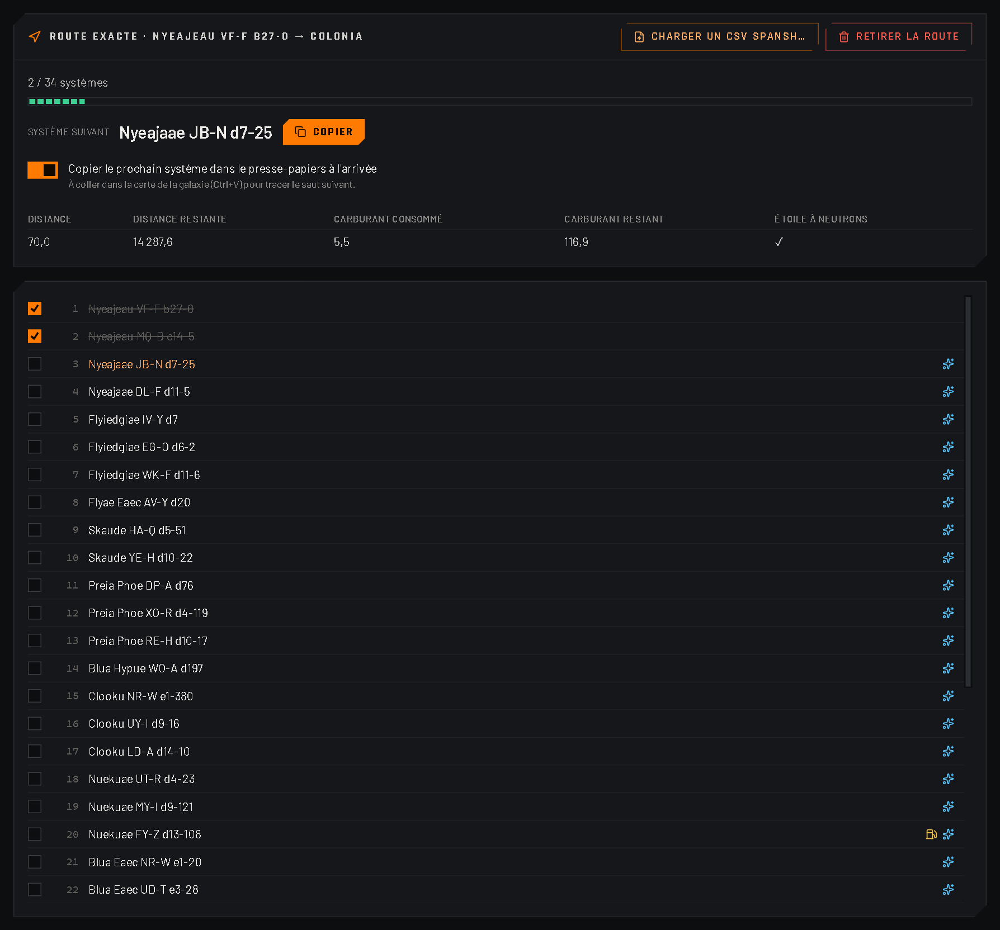</td>
    <td width="45%" valign="top">Dans <i>Exploration → Route Spansh</i>, le nouveau calcul <b>Route exacte</b> passe par le calculateur de la galaxie de Spansh avec <b>ton propre vaisseau</b> : le FSD et son ingénierie, les réservoirs, la masse, la cargaison, le booster FSD gardien et le ×6 du FSD SCO Mk II.  Chaque saut donne le carburant consommé et restant, et la liste signale <b>où faire le plein</b>, les <b>étoiles à neutrons</b> et les <b>injections FSD</b>. Sûr même avec un petit réservoir.</td>
  </tr>
</table>

Quatre options : passer par les étoiles à neutrons, FSD déjà suralimenté au départ, utiliser les injections FSD, éviter les étoiles secondaires. Les champs **Départ** et **Arrivée** complètent les noms de systèmes, et **Système connu le plus proche** part du système le plus proche de toi que Spansh connaît, quand il ne connaît pas encore le tien. Ces fonctions reprennent celles d'[Auto_Neutron](https://github.com/Numerlor/Auto_Neutron), de Numerlor.

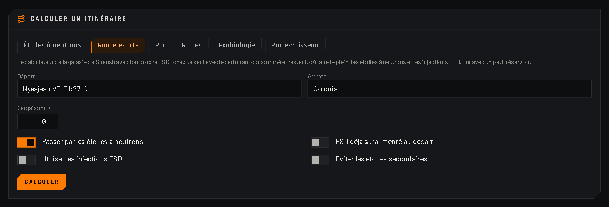

### Et aussi

- **Portée juste pour les vaisseaux allégés par une mise à jour du jeu** (le Mandalay par exemple) : la masse de la coque vient maintenant du jeu. La portée calculée était trop courte de plusieurs années-lumière, et l'alerte carburant de la route restait désactivée pour eux.

## Nouveautés de la 0.2.7

### Le marché de ton porte-vaisseau

<table>
  <tr>
    <td width="45%" valign="top">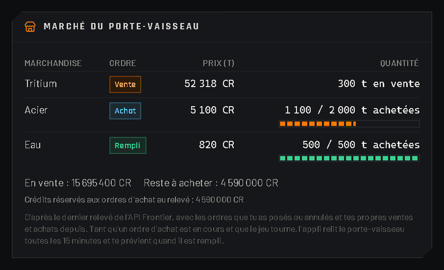</td>
    <td width="55%" valign="top">Dans <i>Activités → Porte-vaisseau</i>, la carte <b>Marché</b> liste tes ordres de vente et d'achat, avec les prix et la progression de chaque achat ; la soute donne la valeur de chaque marchandise.  Tant qu'un ordre d'achat est ouvert et que le jeu tourne, Nova Connector relit le porte-vaisseau toutes les 15 minutes et une <b>notification Windows</b> te prévient quand il est rempli.  Pour le <b>tritium</b> : ce qu'il faut pour remplir le réservoir ou faire un trajet, ce que ta soute en contient déjà, et où acheter le reste.</td>
  </tr>
</table>

### Objectifs communautaires : où acheter, où miner

Chaque objectif donne sa distance depuis ta position. Pour un objectif de commerce ou de minage, **Où acheter** liste les stations qui vendent chaque marchandise autour de l'objectif ou de toi, et **Où miner** ouvre la recherche de points chauds sur le bon minerai autour de l'objectif. Une notification Windows prévient quand un nouvel objectif commence, et quand un objectif auquel tu es inscrit se termine dans la journée.

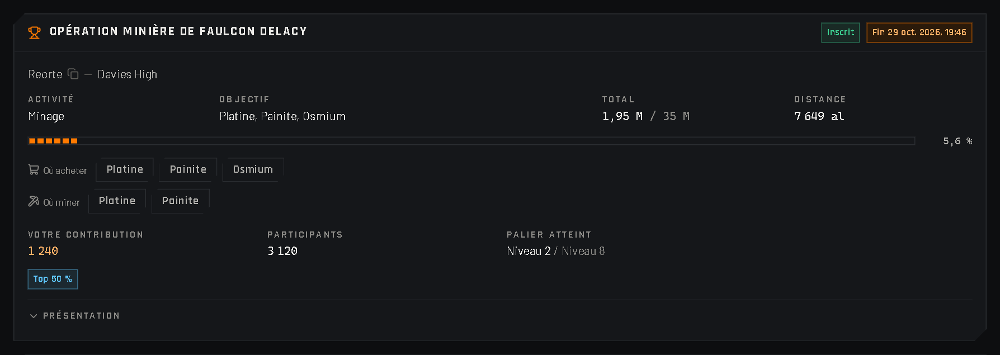

### Ton escadron au complet

Avec la connexion à Frontier, la page **Escadron** montre aussi les avantages et les tags de l'escadron, ses membres (rang, vaisseau, dernière connexion, position quand elle n'est pas masquée), le contenu de sa banque et son porte-vaisseau d'escadron.

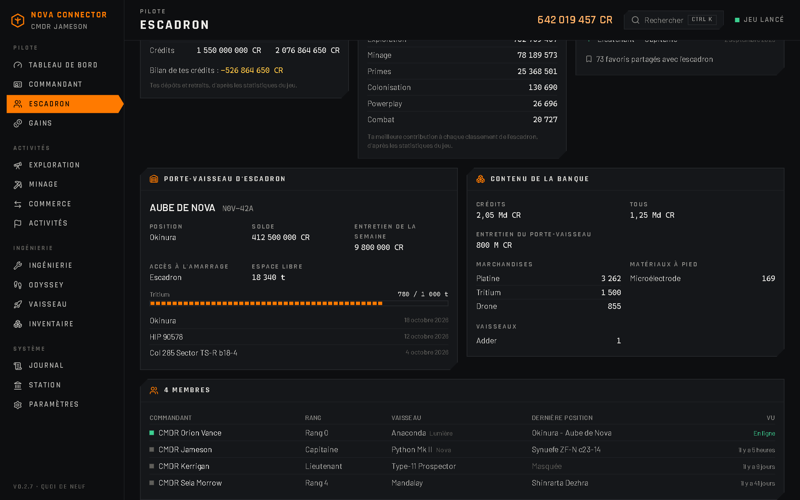

### Et aussi

- **Surimpression en jeu** : le compte à rebours du saut du porte-vaisseau, et ta contribution aux objectifs communautaires après chaque livraison (*Paramètres → Surimpression en jeu*).

## Nouveautés de la 0.2.6

### Tous les objectifs communautaires en cours, même sans inscription

L'onglet *Activités → Objectifs communautaires* affiche tous les objectifs en cours, d'après la liste publique de Frontier : système et station, échéance, marchandises visées, progression vers l'objectif et présentation complète. Quand tu es inscrit, ta contribution, ton palier et ton classement s'y ajoutent ; sinon, Nova Connector t'indique où t'inscrire.

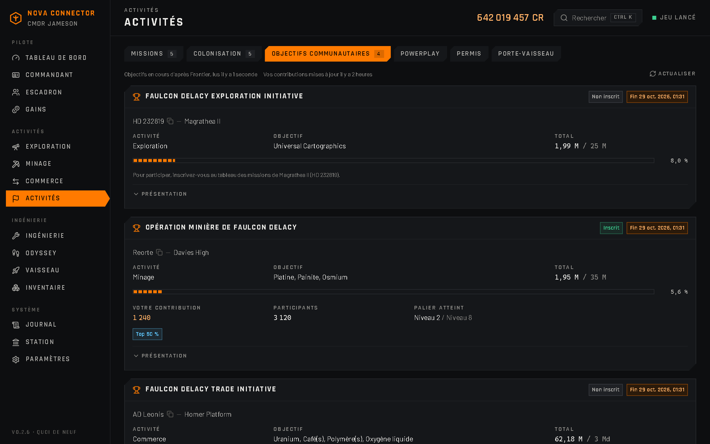

### La soute de ton porte-vaisseau

<table>
  <tr>
    <td width="45%" valign="top">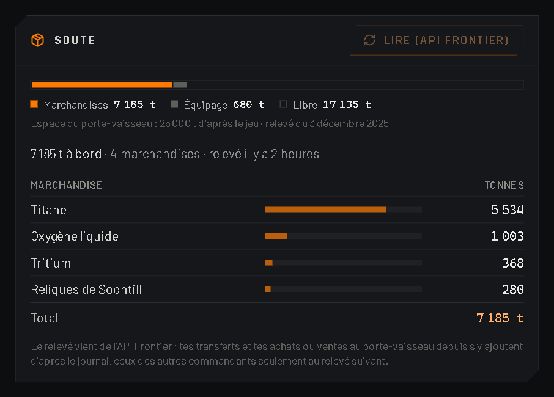</td>
    <td width="55%" valign="top">Dans <i>Activités → Porte-vaisseau</i>, la nouvelle carte <b>Soute</b> liste chaque marchandise à bord, avec le total et la valeur de la cargaison. Le relevé vient de l'API Frontier, puis tes transferts et tes achats ou ventes au porte-vaisseau s'y ajoutent d'après le journal.  Au-dessus, la répartition de l'espace selon le jeu (marchandises, équipage, vaisseaux et modules, libre), visible même sans connexion à Frontier.</td>
  </tr>
</table>

### Une page pour ton escadron

Sous *Commandant*, la page **Escadron** réunit ton rang et son évolution, ta part de la banque de l'escadron et tes meilleures contributions aux classements. Avec la connexion à Frontier : le tag, les membres actifs, le fondateur, l'allégeance, la devise et la mission.

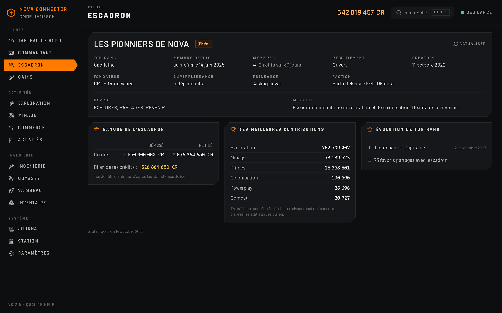

## Correctif de la 0.2.5 : plus de fausse alerte « hors de portée »

La surimpression d'exploration pouvait annoncer qu'un saut de la route était hors de portée du FSD alors qu'il passait. Le calcul a été vérifié sur plus de 6 000 sauts réels : il suit maintenant tout de suite une amélioration du FSD chez un ingénieur, compte le boost d'une étoile à neutrons, d'une naine blanche ou d'une injection FSD, et donne le carburant consommé avec un booster FSD gardien à 0,02 % près (il était sous-estimé, parfois de plus de moitié).

## Nouveautés des 0.2.3 et 0.2.4 : l'exploration par-dessus le jeu

Deux surimpressions qui laissent passer les clics, à placer où tu veux. Depuis la 0.2.4, leur fond est transparent : seuls le texte et les icônes s'affichent, détourés en noir pour rester lisibles, et l'opacité du fond se règle de 0 à 100 %. Elles se règlent dans *Paramètres → Surimpression en jeu (exploration)*, avec le jeu en mode **fenêtré sans bordure**.

<table>
  <tr>
    <td width="40%" valign="top">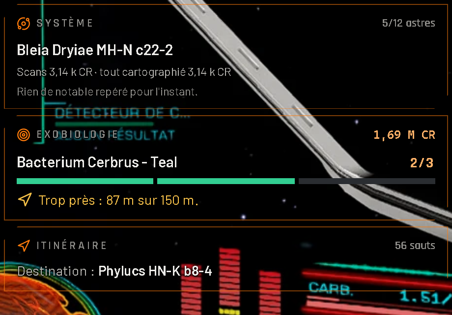</td>
    <td width="60%" valign="top">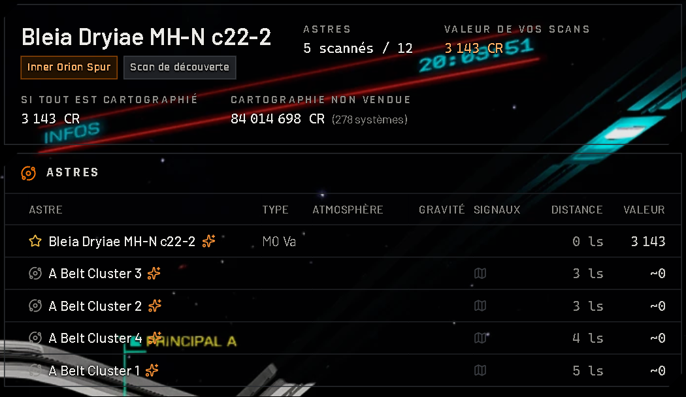</td>
  </tr>
  <tr>
    <td valign="top"><b>Panneaux d'exploration</b> : à l'arrivée, la valeur du système et les astres qui valent le détour ; pendant l'échantillonnage, la distance aux échantillons précédents en direct ; la route et l'alerte carburant.</td>
    <td valign="top"><b>Tableau du système</b> : le système actuel comme sur la page Exploration, en permanence et à jour à chaque scan, dans sa propre fenêtre.</td>
  </tr>
</table>

## Nouveautés de la 0.2.2

### Où acheter un module ou un vaisseau

**Ctrl+K**, puis le nom d'un module ou d'un vaisseau : les stations les plus proches qui le vendent, avec le prix, la plateforme et la date du relevé. Pour un module, tu choisis la taille, la classe et la monture ; le réacteur FSD normal et le FSD à survoltage (SSN) sont bien distingués. Dans le constructeur de vaisseau, un bouton à côté de chaque module et de la coque ouvre directement la bonne recherche. Elle part de ta position, même dans un système que Spansh ne connaît pas encore.

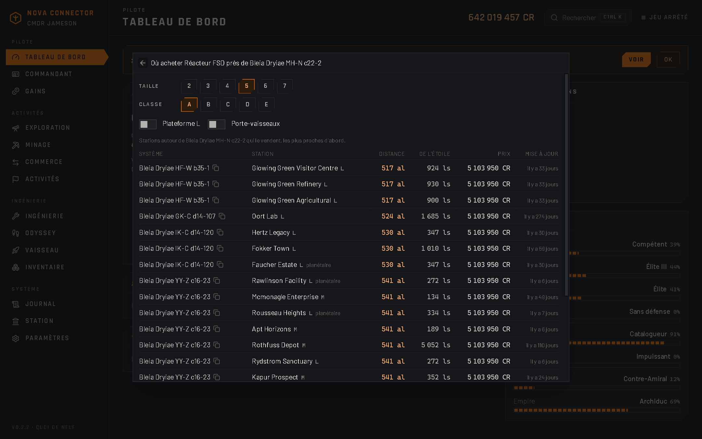

### Un assistant au premier lancement

La langue, le journal du jeu, le partage avec EDDN, EDSM et Inara, la connexion à Frontier : tout se règle en cinq écrans. Il se rouvre depuis *Paramètres → Aide et diagnostic*.

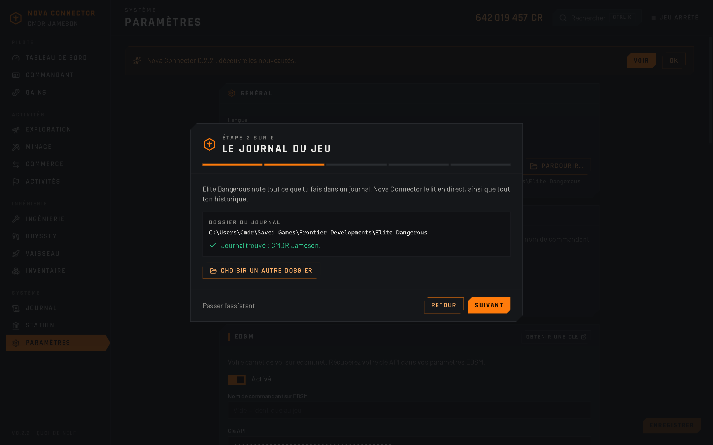

### Et aussi

- **Aide et diagnostic** (Paramètres) : un rapport à coller quand tu [signales un problème](https://github.com/sebhoudelet-afk/NOVA-CONNECTOR-releases/issues/new?template=bug.yml), sans tes clés API, ton nom de commandant ni ton identifiant Frontier.
- **Noms français du jeu** pour des marchandises, des matériaux et des modules mal traduits ou pas traduits ; rangs de mercenaire, d'exobiologiste et de CQC en français.
- Cases à cocher, curseurs et listes au style de l'interface ; surimpression en jeu aux coins coupés.
- Le code source de chaque version est joint à sa page de téléchargement.

## Nouveautés de la 0.2.0

### Une nouvelle interface

La clarté des terminaux d'Odyssey avec la signature du HUD du vaisseau : sélection orange, coins coupés, jauges segmentées, titres en capitales espacées et un menu regroupé par thème (Pilote, Activités, Ingénierie, Système).

### Colonisation : où acheter, quoi acheter, à quel rythme

Un clic sur une ressource liste les stations qui en vendent autour du chantier ou de toi, avec le stock, le prix et la distance. Le **plan d'achat** trouve le minimum d'arrêts pour tout ce qui manque, en déduisant ce qui est déjà dans ta soute et ton porte-vaisseau.

<table>
  <tr>
    <td width="50%">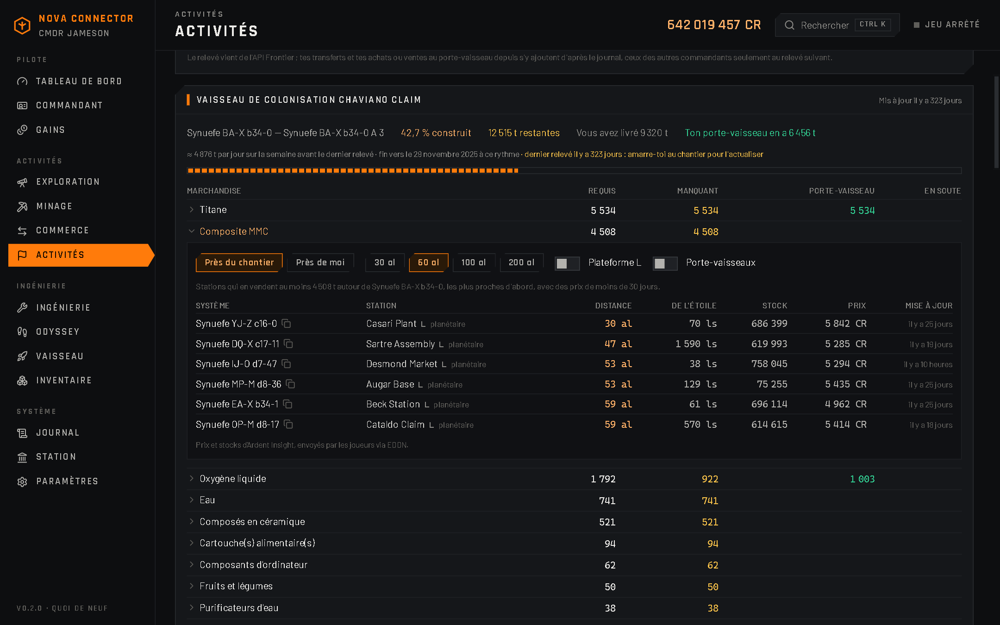</td>
    <td width="50%">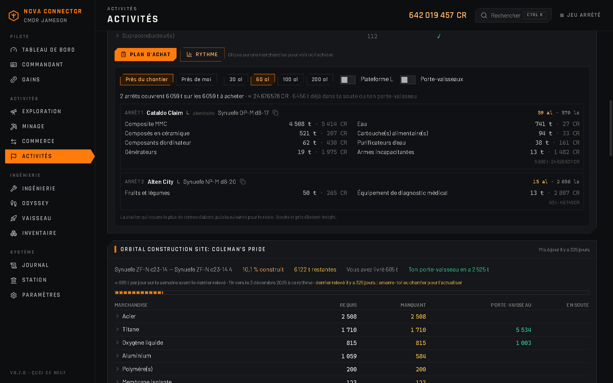</td>
  </tr>
  <tr>
    <td align="center">Où acheter chaque ressource (prix et stocks d'Ardent Insight)</td>
    <td align="center">Plan d'achat : la station qui couvre le plus de tonnes d'abord</td>
  </tr>
</table>

Le stock de ton porte-vaisseau est lu par l'API Frontier et tenu à jour avec le journal. Le **rythme des livraisons** donne une date de fin estimée pour chaque chantier.

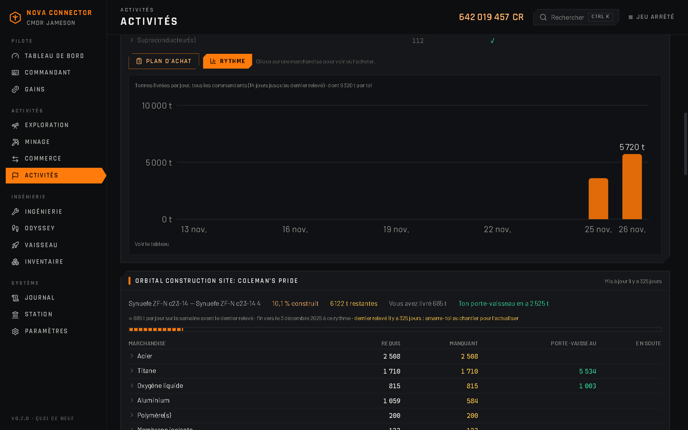

### Les finances du porte-vaisseau

L'entretien de chaque semaine, poste par poste (base, services actifs ou suspendus, sauts), le **solde estimé aujourd'hui** et le nombre de semaines qu'il paie encore. Une notification Windows prévient quand il baisse.

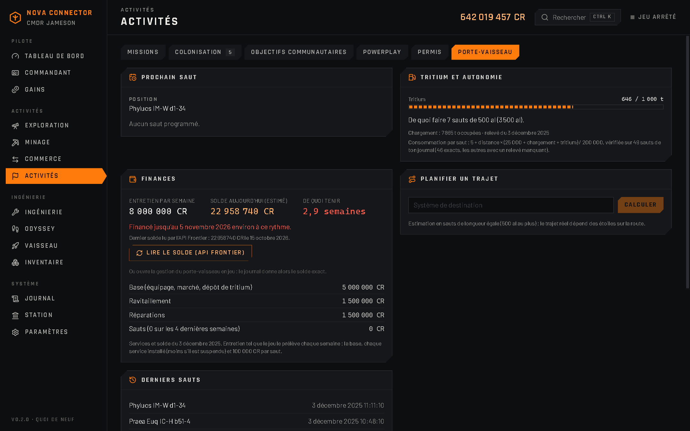

### Gains et commerce

D'où viennent tes crédits, par activité, par semaine et par session de jeu. Le bénéfice de tes ventes, et des itinéraires d'achat-revente calculés par Spansh depuis ta station.

<table>
  <tr>
    <td width="50%">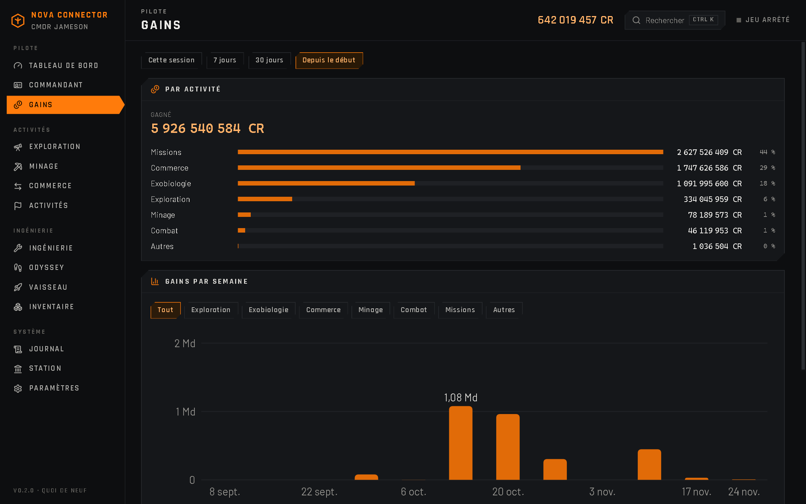</td>
    <td width="50%">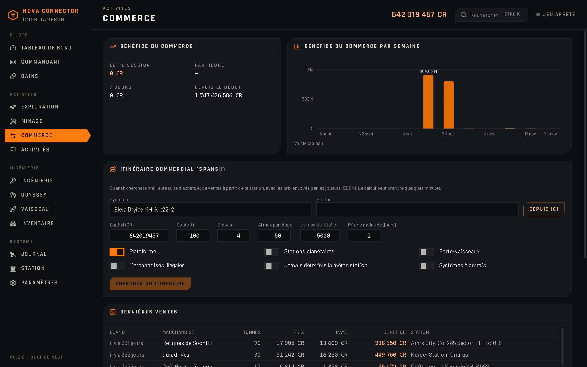</td>
  </tr>
</table>

### Routes Spansh dans l'appli

Étoiles à neutrons, Road to Riches, exobiologie ou porte-vaisseau : la route se calcule sans quitter l'appli, et le prochain système est copié dans le presse-papiers à chaque arrivée. Il n'y a plus qu'à le coller dans la carte de la galaxie.

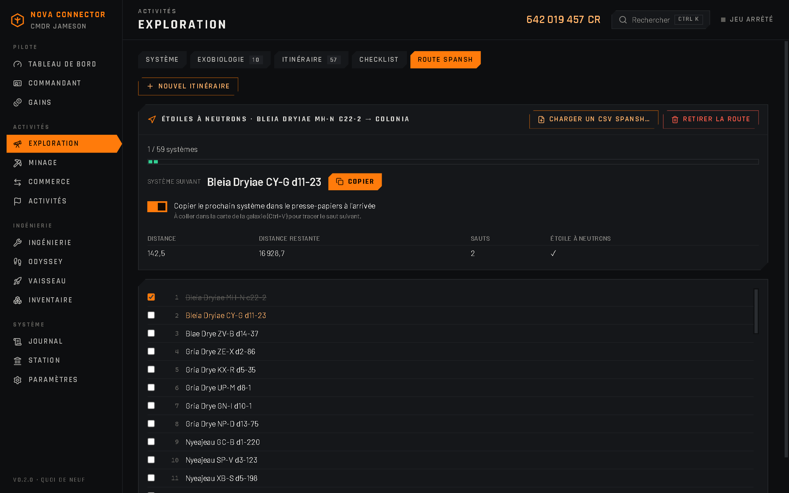

### Recherche rapide

**Ctrl+K** n'importe où : une page, une marchandise (et où l'acheter près de toi), un matériau, un ingénieur, une route vers un système.

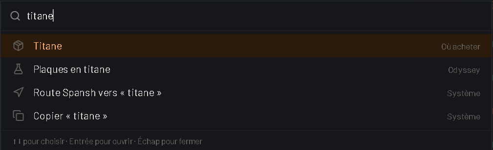

### Et aussi

- **Missions en cours** et **piles de massacre** : éliminations comptées par faction, ratio de la pile, crédits par élimination.
- **Notifications Windows** : mission qui expire, pile de massacre terminée, saut du porte-vaisseau, chantier terminé, solde du porte-vaisseau bas.
- Une page **Quoi de neuf** après chaque mise à jour.
- Le mode test EDDN est retiré : les données partent directement vers les vrais schémas.

## Tout ce que fait Nova Connector

| Page | Ce qu'on y trouve |
|---|---|
| **Tableau de bord** | Commandant, crédits, position, état du vaisseau, rangs, Powerplay, itinéraire tracé |
| **Escadron** | Ton rang et son évolution, banque de l'escadron, contributions aux classements ; avec la connexion Frontier : tag, allégeance, avantages, membres, contenu de la banque, porte-vaisseau d'escadron |
| **Partage** | EDDN, EDSM et Inara, avec une file d'attente qui ne perd rien quand un service est injoignable ; API Frontier |
| **Exploration** | Valeur de chaque astre, espèces d'exobiologie prédites, suivi des échantillons, données non vendues, routes Spansh (dont la route exacte pour ton vaisseau), surimpressions en jeu |
| **Ingénierie** | Matériaux, ingénieurs de vaisseau et à pied, listes de souhaits, négociants, constructeur de vaisseau |
| **Minage** | Sessions, prospections, rendement, annonces vocales, points chauds, meilleurs prix de vente |
| **Activités** | Missions, colonisation, objectifs communautaires en cours (même sans inscription, avec où acheter et où miner), Powerplay, permis, porte-vaisseau (soute, marché, tritium) |
| **Gains et commerce** | Crédits par activité et par session, bénéfice du commerce, itinéraires Spansh |
| **Où acheter** | Marchandises, modules et vaisseaux : les stations les plus proches de toi ou d'un chantier |

Interface en français et en anglais.

## Crédits

Nova Connector s'appuie sur les services de la communauté : [EDDN](https://github.com/EDCD/EDDN), [EDSM](https://www.edsm.net), [Inara](https://inara.cz), [Spansh](https://spansh.co.uk) et [Ardent Insight](https://ardent-insight.com). Ses fonctions reprennent et prolongent celles d'[EDMarketConnector](https://github.com/EDCD/EDMarketConnector), d'[OD Explorer](https://github.com/WarmedxMints/OD-Explorer), d'[EDOMH](https://github.com/jixxed/ed-odyssey-materials-helper), d'[EliteMining](https://github.com/Viper-Dude/EliteMining) et d'[Auto_Neutron](https://github.com/Numerlor/Auto_Neutron).

Licence GPL-3.0 ou ultérieure : le code source de chaque version est joint à sa page de [téléchargement](https://github.com/sebhoudelet-afk/NOVA-CONNECTOR-releases/releases) (`nova-connector-X.Y.Z-sources.zip`). Elite Dangerous est une marque de Frontier Developments plc ; Nova Connector n'est pas affilié à Frontier Developments.

---

<b>English</b>

**Nova Connector** is a companion app for Elite Dangerous: your game journal live, your data shared with EDDN, EDSM and Inara, and tools for exploration, engineering, mining, trade, colonisation and your fleet carrier. The interface is available in English (Settings).

**Install**: download `Nova.Connector_x.y.z_x64-setup.exe` from the [latest release](https://github.com/sebhoudelet-afk/NOVA-CONNECTOR-releases/releases/latest). The installer isn't signed yet, so Windows SmartScreen warns on first launch ("More info", then "Run anyway"). Later versions install themselves. For market, shipyard, carrier and squadron data, log in once from **Station → Log in with Frontier**: nothing else to set up.

**New in 0.2.8**: an "Exact route" plotter in the Spansh route tab, from Auto_Neutron: Spansh's galaxy plotter with your own ship (drive and its engineering, tanks, mass, cargo, guardian booster, the SCO Mk II's ×6), each jump with the fuel used and left, refuels, neutron stars and FSD injections; system names completed in the start and destination fields, and the nearest system Spansh knows when it doesn't know yours; the right range for ships a game update made lighter (the Mandalay for one).

**New in 0.2.7**: the fleet carrier's market (sell and buy orders, each commodity's value, a notification when a buy order is filled) and its tritium (what the tank or a trip needs, what the hold has, where to buy the rest); community goals with their distance, where to buy and where to mine, and notifications when one starts or one you signed up for ends; the squadron's perks, tags, members, bank and carrier with the Frontier login; overlay panels for the carrier's jump countdown and your community goal contributions.

**New in 0.2.6**: all the running community goals, even without signing up (from Frontier's public list, with your contribution when you signed up); the fleet carrier's hold, commodity by commodity, with how its space is used; a Squadron page (your rank and its changes, squadron bank, leaderboard contributions, and with the Frontier login the tag, active members, founder and allegiance).

**Fixed in 0.2.5**: no more false "out of the FSD's range" alerts on the route (engineer upgrades, neutron/white dwarf boosts and FSD injection taken into account), and the right fuel figures with a guardian FSD booster.

**New in 0.2.4**: transparent overlays (only the outlined text shows over the game), with the background's opacity to set.

**New in 0.2.3**: in-game overlays for exploration (arrival in a system, sampling distance, route and fuel) and a second overlay with the current system's table.

**New in 0.2.2**: where to buy a module or a ship near you (Ctrl+K or the ship builder, with size, rating and mount), a welcome assistant on first launch, a diagnostic report for bug reports, the game's French names, and each version's source code attached to its release.

**New in 0.2.0**: a new interface; colonisation shopping lists (where to buy each resource, fewest stops, carrier cargo deducted, delivery pace); fleet carrier upkeep and estimated balance; earnings and trade pages; Spansh routes plotted in the app with the next system copied on arrival; quick search (Ctrl+K); missions and massacre stacks; Windows notifications.

